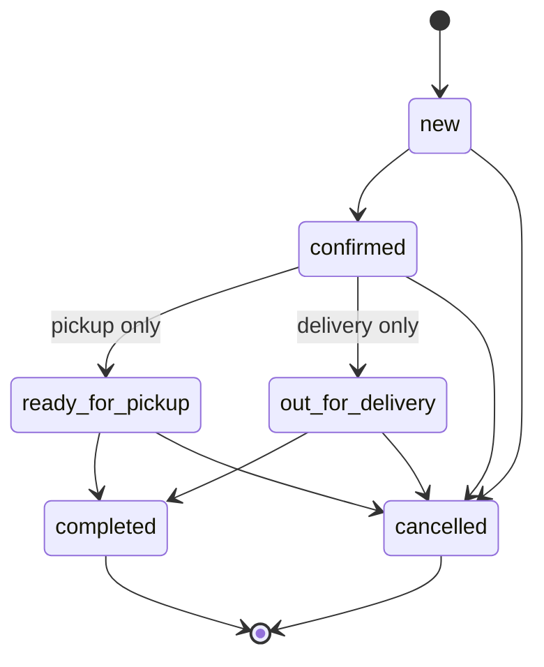

# Order lifecycle

Orders move forward only. `changeOrderStatus` (`app/lib/orders.ts`) is the single place status changes happen. Signature: `changeOrderStatus(db, actor: StaffRecord, { orderId, to, note? })`. It calls `authorize(actor, "orders.manage")` first (inactive or unauthorised staff get `forbidden`) and records `actor.userId` on the event; a non-UUID `orderId` is `not_found`.

Anything else (going back, skipping, leaving `completed` or `cancelled`) fails with `invalid_transition`.

## Stock rules

- A new order reserves nothing; placing it only checks stock.
- **Confirm** re-checks stock under lock and decrements each variant. If any variant has less than the ordered quantity the whole change fails with `insufficient_stock` and nothing changes. Stock can run out between placing and confirming, so this check is the real one.
- **Cancel** from `confirmed`, `ready_for_pickup` or `out_for_delivery` adds the quantities back. Cancelling a `new` order leaves stock alone.
- Stock is changed with `stock = stock ± qty` in SQL, never read-modify-write in code. A DB check keeps stock `>= 0`.

## Lock order

Every transaction that touches stock locks the **order row first**, then the order's **variant rows in ascending id** (one `SELECT … ORDER BY id FOR UPDATE`). Same order everywhere means no deadlocks, and two staff confirming orders for the last unit serialize: the first wins, the second sees `insufficient_stock`.

## Idempotency

Re-sending a status change is safe: the order is locked, so the repeat sees the new status and is rejected with `invalid_transition` without touching stock or writing an event. (Checkout idempotency is separate: client key plus payload hash.)

## Events

Every change writes an `order_events` row in the same transaction: from, to, staff user id, optional note. `order_events.staff_user_id` (and `enquiry_events.staff_user_id`) is a nullable FK to `staff.user_id`, `on delete restrict`: staff with history are deactivated, never deleted. Placement writes the first event (`null` to `new`, no staff user).
